

  

<h1 align="center">Pécule</h1>

<b>Tes finances, simplement.</b> 
Comptes, budgets, épargne, courses et vie à plusieurs — gratuit, en français, et tes données restent sur ton PC.

  <a href="https://github.com/zyg-off/pecule/releases/latest/download/Pecule-Setup.exe"><b>⬇️ Télécharger Pécule pour Windows</b></a>
  &nbsp;·&nbsp; Windows 10 et 11 · gratuit · version 1.1.1

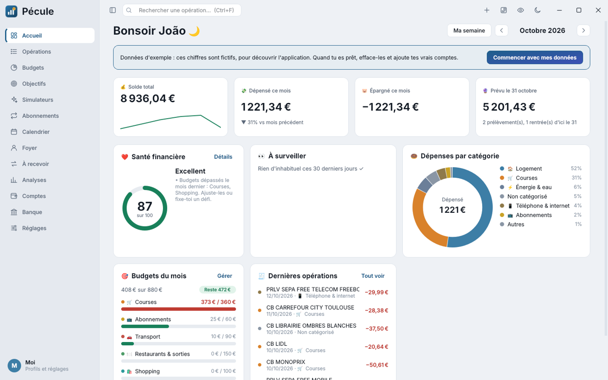

---

## ✨ Ce que fait Pécule

**Au quotidien**
- 🏦 **Connexion à ta banque** (Enable Banking) ou import de relevés CSV / OFX de n'importe quelle banque
- 🏷️ Classement automatique des opérations, avec des règles qui apprennent de tes choix
- 🗂️ Sous-catégories : leur budget compte dans celui de la catégorie principale, et les virements entre comptes se rangent à part
- 🎯 **Budgets** par catégorie, enveloppes, bilan du mois et score de la semaine
- 🔁 **Récurrent** : abonnements et prélèvements détectés tout seuls, rappels avant les gros débits, et **hausses de prix repérées** avec le courrier pour les contester
- 🌤️ La météo du mois : ce qu'il devrait te rester, compte par compte
- 💬 **Pose une question** : « Combien j'ai dépensé en restos cet été ? »
- 🧩 Un Accueil à ta façon : glisse les blocs, choisis les comptes affichés

**Pour épargner**
- 🏆 Objectifs avec coach de rattrapage, défis (« mois sans achat »)
- 🐷 Tous les livrets français (Livret A, LDDS, LEP, PEL…) avec plafonds et intérêts
- 📈 Placements (assurance vie, PEA, cryptos) : plus-value et rendement calculés
- 🧮 Simulateurs : épargne, crédit, achat immobilier, voiture, déménagement, scénarios de vie
- 🔮 Prévision de ton solde sur 6 mois, alerte fin de mois serrée

  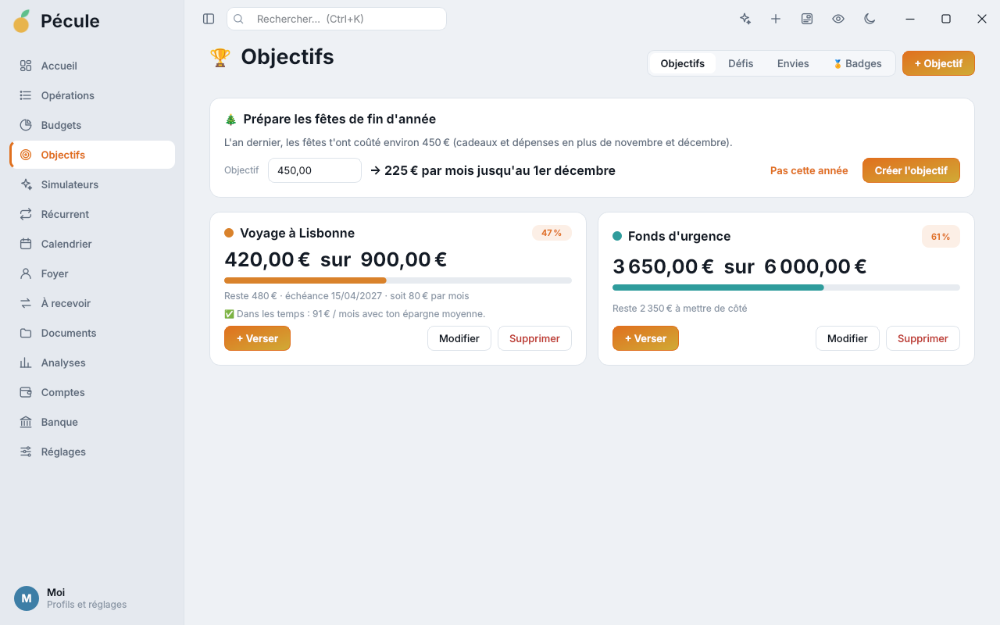
  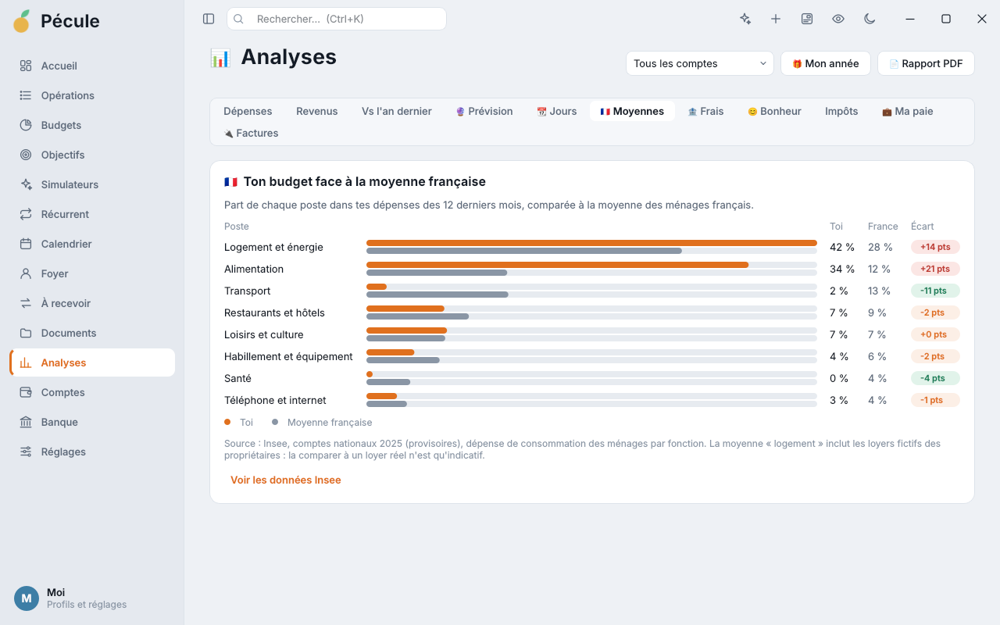

**Pour comprendre**
- 📊 Analyses : dépenses, revenus, comparaison avec l'an dernier, jours de la semaine
- 🇫🇷 Ton budget comparé à la moyenne des ménages français (Insee)
- 🏦 Frais bancaires repérés, rapprochement bancaire
- 🧾 **Aide à la déclaration d'impôts** : dons, emploi à domicile, crèche, cotisations syndicales et PER retrouvés dans tes opérations, case par case
- 🤝 **Mes aides possibles** : prime d'activité, aide au logement, complémentaire santé solidaire, chèque énergie, rentrée scolaire, avec les simulateurs officiels
- 💼 **Ma paie** : lecture de tes bulletins (PDF, scan ou photo) avec la ligne d'où vient chaque montant, contrôles de cohérence, réanalyse en un clic, prévision de ton prochain salaire et vérification du salaire reçu
- 🔌 **Comparateur de factures** : énergie, box et forfait mobile, avec l'économie possible
- 😊 Jauge de bonheur de tes achats
- 🎁 Ton année en récap animé, badges à débloquer, rapport PDF mensuel

  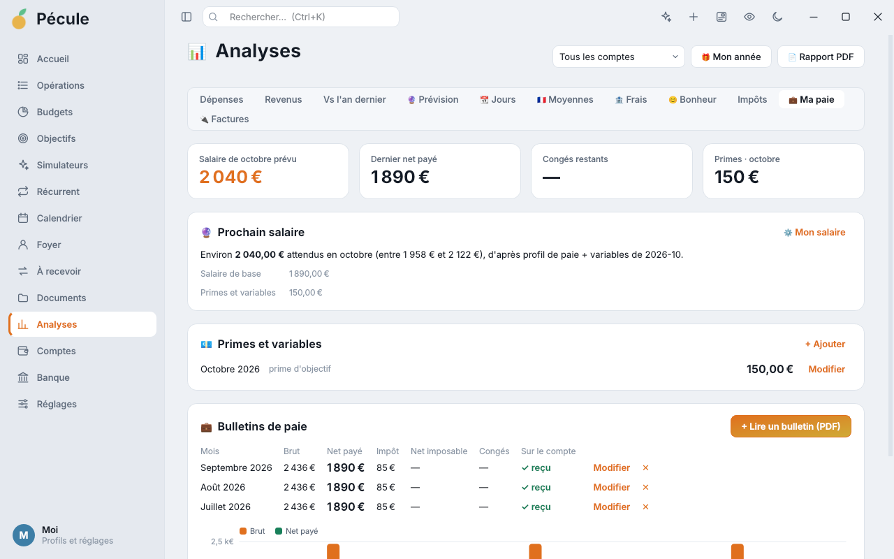
  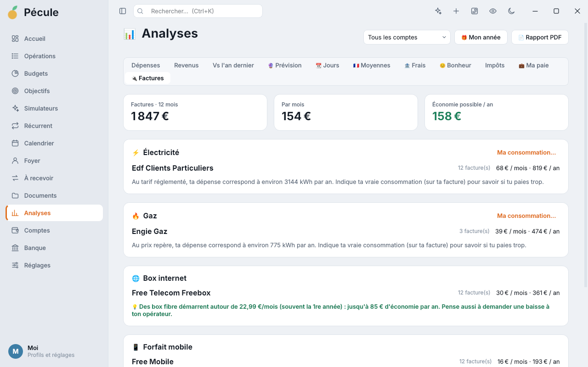

**Courses et maison**
- 🛒 **Liste de courses partagée** avec budget du panier
- 🏪 **Le magasin le moins cher** pour ta liste (tes prix et ceux de la communauté Open Prices), promos près de chez toi
- 📷 Lecture des tickets de caisse (photo ou PDF)
- 📦 **Stock de la maison** : ce qui passe sous le nécessaire rejoint la liste, dates de péremption avec un rappel la veille et des recettes pour finir les produits
- 📷 **Scan des codes-barres** : le produit s'ajoute à la liste ou au stock avec son nom et son prix (Open Food Facts)
- 🍝 **Repas de la semaine** : des idées selon vos goûts, votre régime et vos allergies, et les ingrédients qui manquent rejoignent la liste de courses

  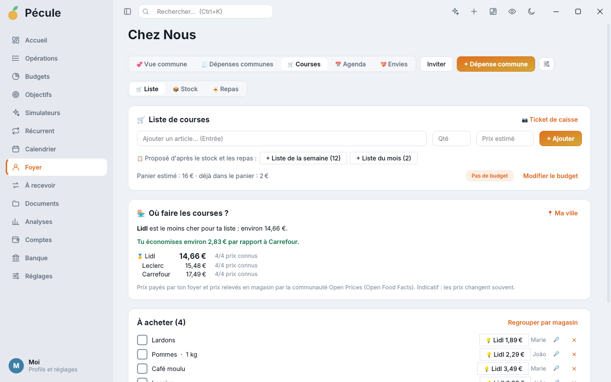
  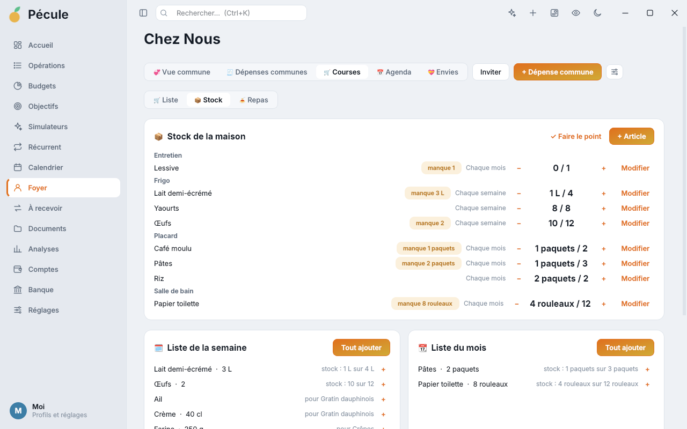

  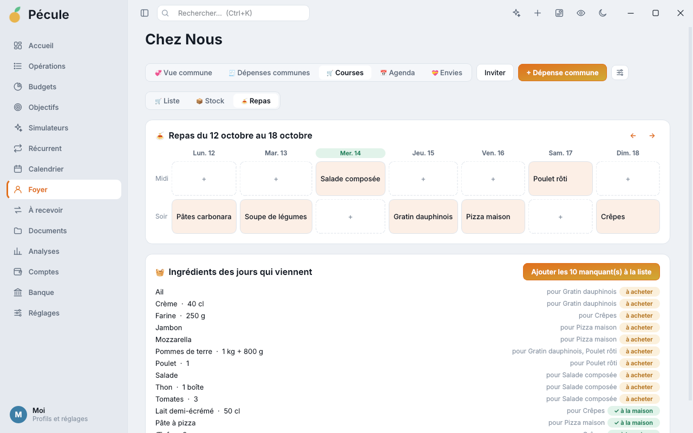
  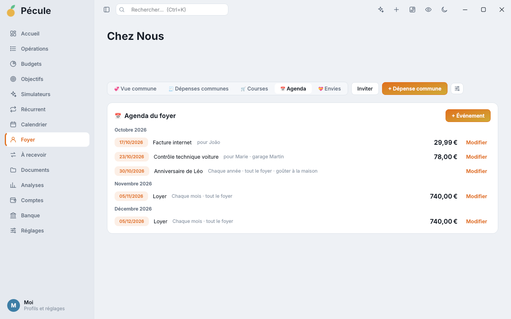

**Les grands moments**
- 🎁 **Cadeaux** pour toutes les occasions : anniversaires, Noël, fête des mères et des pères, mariage, naissance… avec budget et rappel
- 💝 **Listes d'envies** : chacun note ses envies, les autres réservent sans gâcher la surprise
- ✈️ **Voyages et événements** : un budget à part pour un séjour, un mariage, un déménagement, des travaux ou Noël, sans fausser tes budgets du mois

  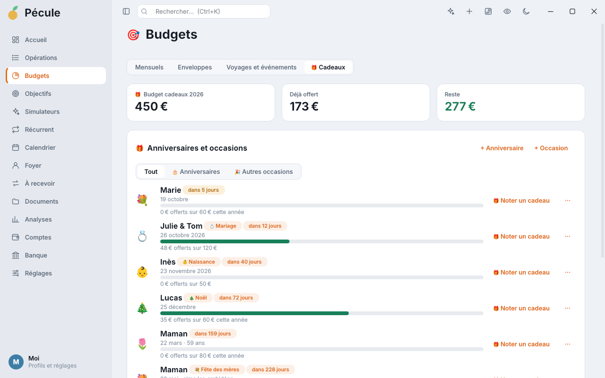
  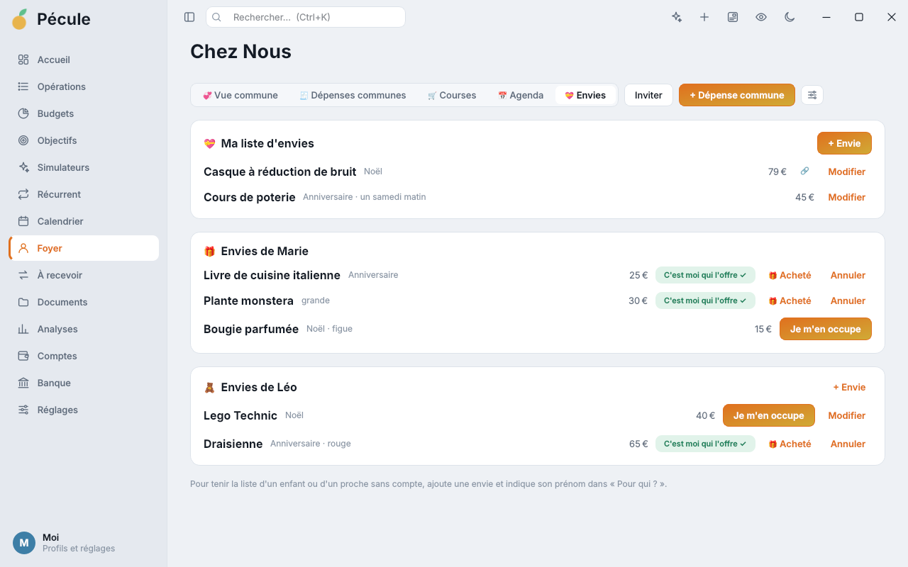

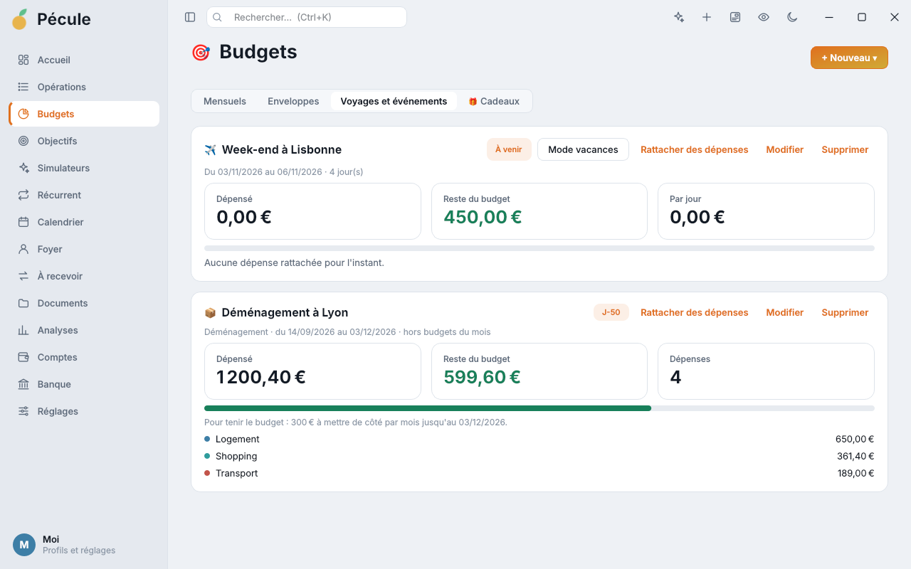

**Tes papiers**
- 📁 Documents classés par mois, modifiables par lots, partagés avec ton foyer
- 🏠 Quittances de loyer rangées toutes seules, suivi du dépôt de garantie, dossier de location complet en PDF
- ✉️ **21 courriers prêts à envoyer**, avec le mode d'envoi et les pièces à joindre : résiliations, préavis, dépôt de garantie, charges locatives, frais bancaires, facture contestée, vice caché, démission, salaire impayé, argent prêté, délais de paiement…

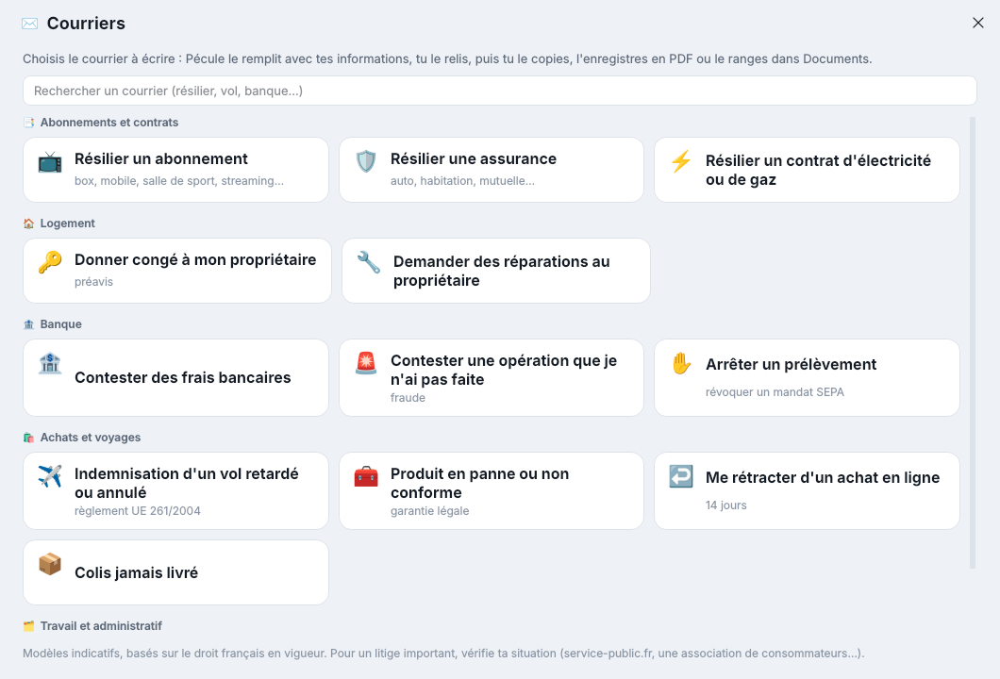

**À plusieurs**
- 💞 **Foyer** : dépenses communes, qui doit combien, budgets et objectifs communs, vue commune en direct
- 👥 **Comptes communs vraiment partagés** : la part de chacun, le suivi des versements et un rappel pour ta part
- 📅 **Agenda du foyer** : loyer, factures, rendez-vous, avec un rappel la veille
- 🧹 **Tâches ménagères** : à tour de rôle ou par n'importe qui, avec un rappel le jour J
- 📱 **Le foyer sur ton téléphone** : courses (avec scan des codes-barres), stock, repas, tâches, envies, dépenses communes, agenda et soldes. La page reste connectée (QR code dans Pécule)
- 🧾 Dépenses entre amis (week-end, coloc) sans que les autres aient l'appli
- 👤 Plusieurs profils protégés par un code

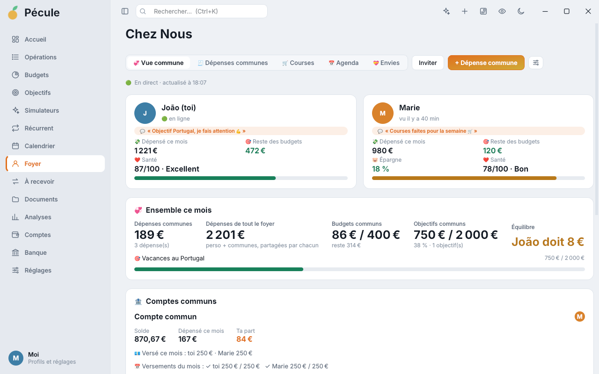

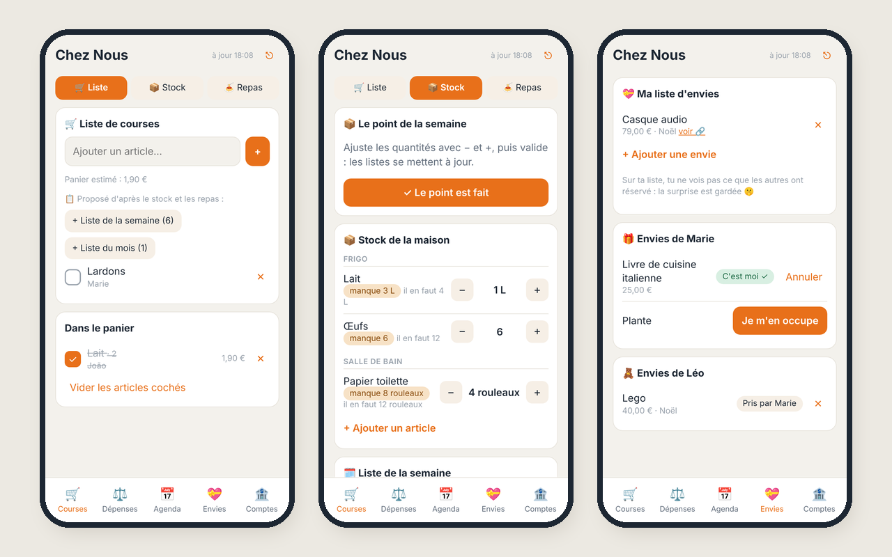

**Confort**
- 🛟 Sauvegarde automatique chaque jour, corbeille de 30 jours, Ctrl+Z pour annuler
- 🔎 Ctrl+K pour tout retrouver, navigation complète au clavier
- 🎨 Thèmes clair, sombre, Néon, Pastel, Océan, Forêt et Contraste élevé
- 🌍 En français, anglais et portugais

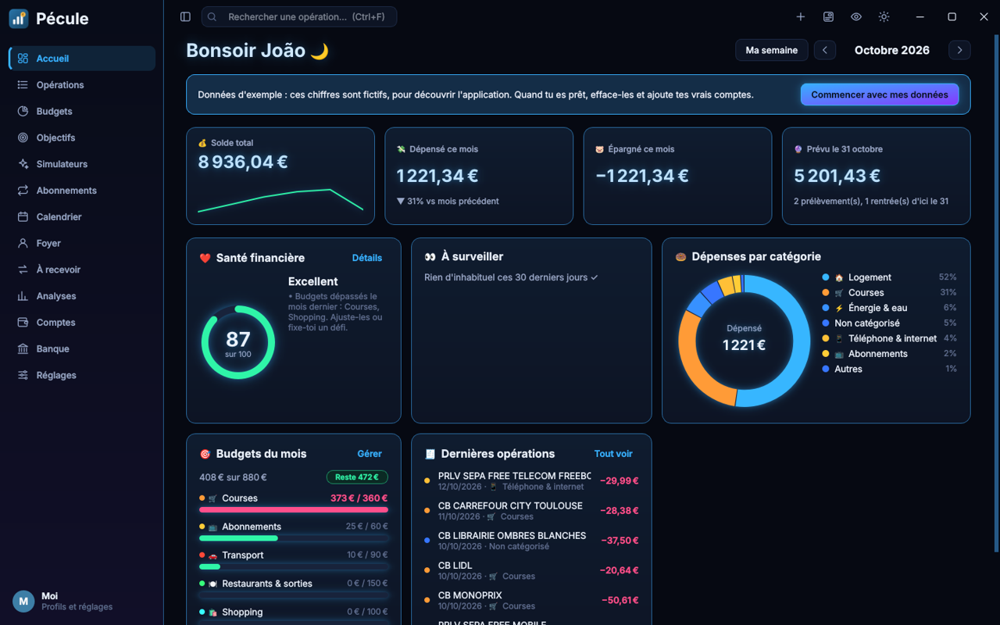

## 📥 Installer

1. **[Télécharge Pecule-Setup.exe](https://github.com/zyg-off/pecule/releases/latest/download/Pecule-Setup.exe)** et ouvre-le.
2. Si Windows affiche « Windows a protégé votre ordinateur » : clique sur **Informations complémentaires**, puis **Exécuter quand même**.
   (L'installateur n'est pas encore signé numériquement, ce message est normal.)
3. Suis l'assistant : 2 à 4 minutes, avec Internet. Pas besoin d'être administrateur.
4. Ouvre Pécule depuis le Bureau ou le menu Démarrer, et laisse-toi guider.

**Mises à jour** : Pécule te prévient quand une nouvelle version est disponible et l'installe en un clic. Tes données sont conservées.
**Désinstaller** : Paramètres Windows › Applications › Pécule.

## 🔐 Tes données

- Tes comptes et tes opérations sont enregistrés **uniquement sur ton ordinateur** (`%APPDATA%\Pecule`). Aucun compte Pécule, aucune publicité, aucune collecte.
- La connexion bancaire passe par **ton propre accès Enable Banking** (gratuit pour tes comptes personnels).
- Le foyer partagé utilise **ton propre serveur Supabase gratuit**. Seul ce que tu partages avec le foyer y est envoyé : dépenses communes, courses, stock, repas, agenda, tâches, envies et documents que tu envoies. Tes chiffres personnels n'y vont que si tu actives le partage.
- La page téléphone ne contient aucune donnée : elle se connecte simplement à ton serveur du foyer.

## ❓ Questions fréquentes

**C'est vraiment gratuit ?** Oui.

**Ça marche sur Mac ou sur téléphone ?** L'application est pour Windows 10 et 11. Sur téléphone, une page web donne accès au foyer (courses, stock, repas, tâches, envies, dépenses communes, agenda) : scanne le QR code dans Pécule › Foyer › ⚙ › Sur mon téléphone. Pas de version Mac pour l'instant.

**Ma banque est compatible ?** La connexion directe couvre la plupart des banques françaises et européennes. Sinon, l'import de relevés CSV / OFX marche avec toutes.

**Je peux l'utiliser en anglais ou en portugais ?** Oui : Réglages › Langue.

**Un problème, une idée ?** Ouvre une [discussion ou un signalement](https://github.com/zyg-off/pecule/issues).

---

Pécule est un logiciel gratuit, dont le code n'est pas public. © 2026 · Licence d'utilisation incluse dans l'installateur.
Il s'appuie sur des logiciels libres (Python, Qt / PySide6…) listés dans « Composants utilisés ». Pécule ne fournit pas de conseil financier.
